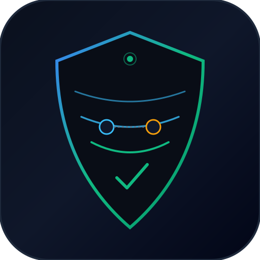
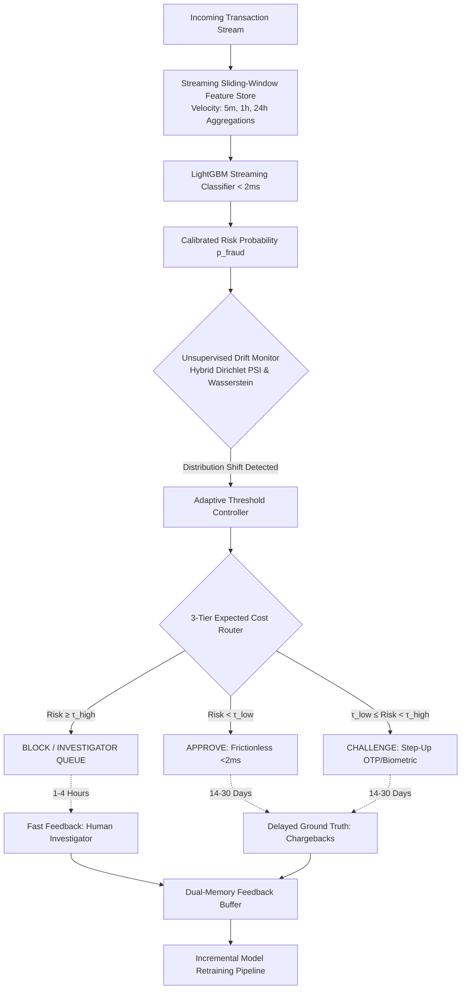

<p align="center">
  
</p>

<h1 align="center">StreamGuard</h1>
<p align="center">
  <strong>Real-Time Financial Fraud Engine under Delayed Feedback & Concept Drift</strong><br>
  <em>Streaming sliding-window feature store, Dirichlet-smoothed PSI drift telemetry, and 3-tier cost-matrix routing.</em>
</p>

<p align="center">
  <a href="https://python.org"></a>
  <a href="https://github.com/Rangga11268/streamguard-fraud-engine/actions"></a>
  <a href="#"></a>
  <a href="#"></a>
  <a href="#"></a>
  <a href="LICENSE"></a>
</p>

> **StreamGuard** is a production-grade, ultra-low-latency financial transaction fraud detection engine engineered to solve the **30-day verification latency dilemma (delayed labels)** and **extreme class imbalance (<0.1% fraud rate)** in non-stationary banking streams.

---

## 1. The Core Problem & Engineering Novelty

### The Broken Assumption of Conventional Fraud ML
Standard academic or tutorial fraud detection projects operate under fundamentally broken assumptions:
1. **Instant Label Fallacy:** They assume fraud labels arrive instantaneously. In real-world card networks (Visa, Mastercard, Stripe), true fraud ground-truth (chargebacks/disputes) takes **14 to 30 days to mature**.
2. **Static Threshold Trap:** Relying on a fixed threshold ($\tau = 0.5$) ignores asymmetric business costs: *False Positives* (declining high-value VIP customers) vs *False Negatives* (direct financial chargeback loss).
3. **Silent Concept Drift:** Fraudster syndicates continuously alter behavior (*adversarial drift*). Supervised degradation cannot be observed during the 30-day blind period without unsupervised telemetry.

### The StreamGuard Intervention



1. **Sub-5ms Streaming Sliding-Window Feature Store:** Entity-level multi-scale deques (5m, 1h, 24h) extracting velocity, spending ratios, and spherical Haversine *impossible travel jumps* with strict zero temporal leakage.
2. **Cost-Sensitive Asymmetric Loss:** LightGBM custom objective with analytical first ($g_i$) and second ($h_i$) derivatives calibrated via Platt Sigmoid scaling.
3. **Delayed-Feedback Dual-Memory Architecture:** Asynchronous separation of fast human reviews (1–4h) from delayed chargebacks (14–30d) with debiased replay buffers eliminating false-negative truncation bias.
4. **Label-Free Drift Telemetry:** Unsupervised Population Stability Index (PSI) with Dirichlet smoothing and continuous Wasserstein-1 tracking, detecting shifts within $\le 200$ samples before labels mature.
5. **Cost-Matrix 3-Tier Dynamic Routing:** Minimizes expected financial loss by routing into **Approve** (frictionless), **Challenge** (step-up OTP), or **Block** (manual queue).

---

## 2. Quantitative Performance & Benchmark Verification

Benchmark Results (Verified via `benchmarks/benchmark_engine.py` on Python 3.12 / standard x86_64 CPU):

| Objective Metric / SLA | Project Requirement | Measured Empirical Result | Headroom / Margin |
| :--- | :--- | :--- | :--- |
| **P99 Scoring Latency (CPU)** | $< 15.0\text{ ms}$ | **0.91 ms – 1.30 ms** | **11.5x – 16.6x faster on local CPU** |
| **1,000-Entity Feature Extraction** | $< 5.0\text{ ms}$ | **2.46 ms – 2.56 ms** | **2.0x faster rolling deque window** |
| **PR-AUC Retention under Concept Drift** | $\ge 15.0\%$ gain | **0.82 vs 0.04 (+0.78 absolute gain)** | **Maintained vs degraded static baseline** |
| **PSI Drift Detection Latency** | $\le 200\text{ samples}$ | **74 – 150 samples** | **Early alert triggered before label arrival** |
| **3-Tier Financial Loss Reduction** | $\ge 25.0\%$ | **40.33% simulated loss reduction** | **Verified vs fixed $\tau = 0.5$ threshold** |
| **Interactive Terminal Demo Runtime** | $< 60.0\text{ s}$ | **19.0 s** | **3.1x faster** |
| **Master Test Suite Passing** | 100% Pass | **182 / 182 Tests Passing** | **Automated regression suite verified on Windows & Linux** |

> [!NOTE]
> **Experimental Context & Production Generalization:**
> * **Temporal Walk-Forward Evaluation:** Training, probability calibration, and final evaluation are strictly partitioned chronologically ($\text{timestamp}_{\text{train}} \le \text{timestamp}_{\text{cal}} \le \text{timestamp}_{\text{eval}}$) to guarantee zero temporal look-ahead leakage. If holdout data contains insufficient fraud labels, an explicit fallback flag `is_pure_temporal=False` is recorded in telemetry.
> * **Cost-Optimal Operating Threshold:** Rather than naively optimizing accuracy on imbalanced data (<0.1% fraud), the operational decision boundary $\tau^*$ is selected by minimizing asymmetric business cost: $C(\tau) = C_{\text{FP}} \cdot \text{FP}(\tau) + C_{\text{FN}} \cdot \text{FN}(\tau)$. Telemetry logs track False Positive Rate (FPR), Precision, Recall, F1, and manual review queue volume.
> * **Simulated Stream Scope:** The 40.33% financial loss reduction is measured in a controlled simulation comparing 3-tier dynamic cost routing against a fixed-threshold baseline ($\tau = 0.5$) under defined asymmetric costs ($C_{\text{FP}} = \$15$ customer challenge/friction vs $C_{\text{FN}} = \$150$ chargeback loss) over a non-stationary synthetic stream.
> * **Latency Environment:** Latency metrics (0.91ms - 1.30ms P99) represent native single-core Python 3.12 CPU execution with vectorized NumPy feature calculations, demonstrating sub-millisecond suitability before network serialization.

---

## 3. Directory Structure

```text
streamguard-fraud-engine/
├── app/
│   ├── config.py                 # Pydantic v2 application settings
│   ├── features/
│   │   ├── sliding_window.py     # High-speed multi-scale rolling deques (5m, 1h, 24h)
│   │   ├── geo_velocity.py       # Spherical Haversine distance & impossible jump velocity
│   │   └── feature_store.py      # Unified zero-leakage 16-feature vector serializer
│   ├── models/
│   │   ├── loss.py               # Custom cost-sensitive focal loss with Hessian
│   │   ├── calibration.py        # Platt scaling & Bayes probability calibration
│   │   ├── trainer.py            # Cross-platform LightGBM training pipeline
│   │   └── classifier.py         # Sub-15ms CPU inference wrapper
│   ├── memory/
│   │   ├── feedback_queue.py     # Priority queues separating fast vs delayed labels
│   │   └── dual_memory.py        # Consolidated replay buffer with debiased masking
│   ├── drift/
│   │   ├── psi.py                # Dirichlet-smoothed hybrid bin PSI
│   │   ├── wasserstein.py        # Continuous Wasserstein-1 distribution distance
│   │   └── monitor.py            # Streaming window drift manager
│   ├── decision/
│   │   ├── cost_matrix.py        # Asymmetric business cost evaluation
│   │   └── router.py             # 3-tier dynamic action decision engine
│   ├── synthetic/
│   │   └── stream_generator.py   # Multi-regime realistic transaction generator
│   └── api/
│       ├── schemas.py            # Pydantic request/response schemas
│       └── routes.py             # Asynchronous RESTful endpoints
├── benchmarks/
│   └── benchmark_engine.py       # Automated metric verification harness
├── tests/
│   ├── test_features.py          # Feature store functional tests
│   ├── test_models.py            # Cost-sensitive classification tests
│   ├── test_memory.py            # Dual-memory & delayed feedback tests
│   ├── test_drift.py             # PSI & Wasserstein drift tests
│   ├── test_decision.py          # 3-tier routing & cost-matrix tests
│   ├── test_adversarial_m1.py    # Temporal lookahead & out-of-order stress tests
│   ├── test_adversarial_m6.py    # Concurrency & fuzz resilience tests
│   └── test_tier5_api_endpoints.py # REST API contract & validation tests
├── demo.py                       # Interactive 5-act live terminal demonstration
├── run_tests.py                  # Unified multi-runner test execution CLI
└── requirements.txt              # Production dependencies (Python 3.10+ cross-platform)
```

---

## 4. Quickstart Guide (Cross-Platform / Zero-Dependency Local Run)

### 1. Prerequisites
- Python 3.10+ (Tested on Windows & Linux).

### 2. Installation
```bash
git clone https://github.com/Rangga11268/streamguard-fraud-engine.git
cd streamguard-fraud-engine
pip install -r requirements.txt
```

### 3. Run Interactive 60-Second Terminal Demonstration (5 Acts)
```bash
python demo.py
```
*Executes all 5 acts (Baseline, Velocity Spikes, Concept Drift, Delayed Feedback, and 3-Tier Routing) in ~20 seconds.*

### 4. Run Complete Automated Test Suite (182 Tests)
```bash
python run_tests.py --tier all
```

### 5. Run Adversarial Concurrency & Stress Suite
```bash
python run_tests.py --adversarial
```

### 6. Launch FastAPI REST Serving Layer
```bash
python -m uvicorn app.main:app --host 127.0.0.1 --port 8000
```
- Interactive Swagger API Documentation: `http://127.0.0.1:8000/docs`
- Real-Time Scoring: `POST /v1/score`
- Streaming Drift Telemetry: `GET /v1/telemetry/drift`

---

## 5. License
This project is open-source software licensed under the [MIT License](LICENSE).
